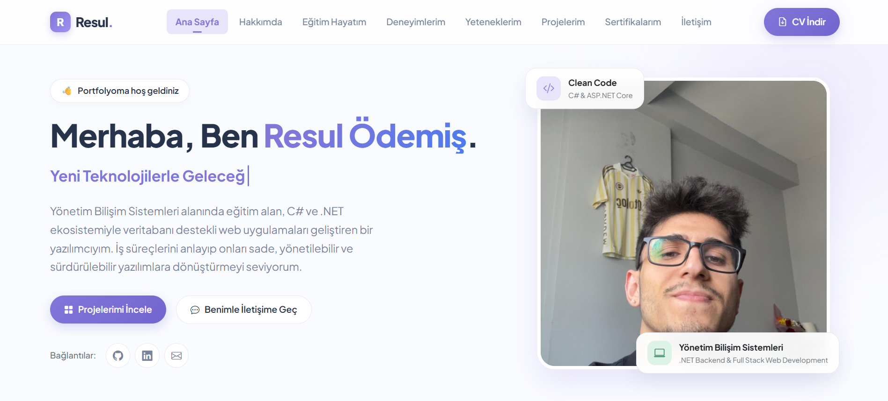
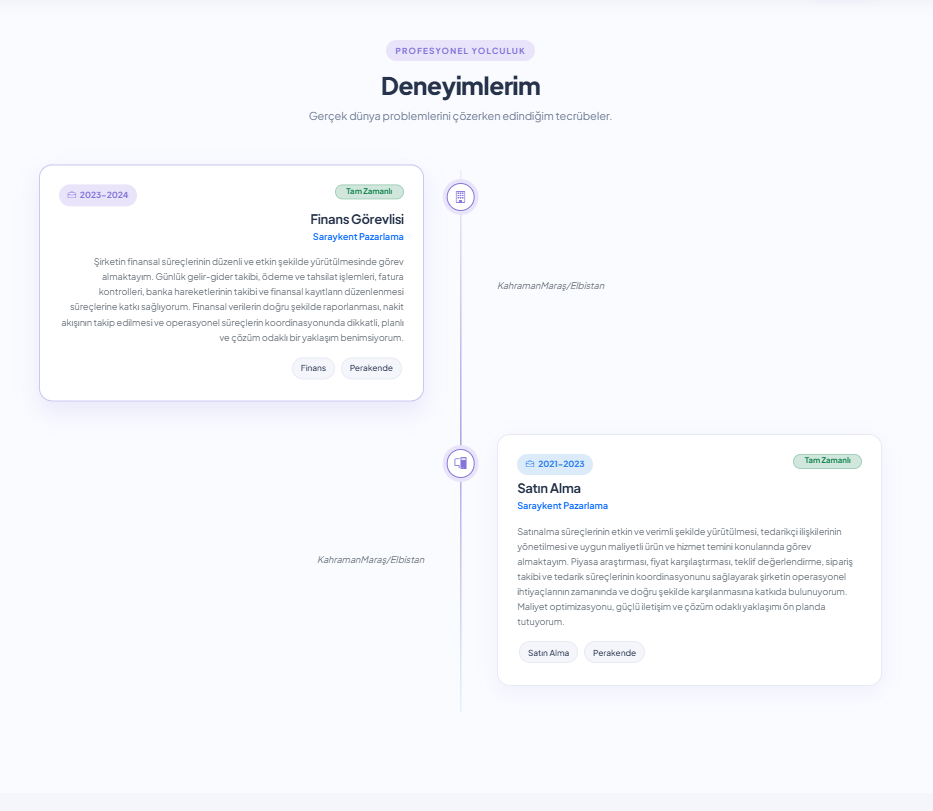
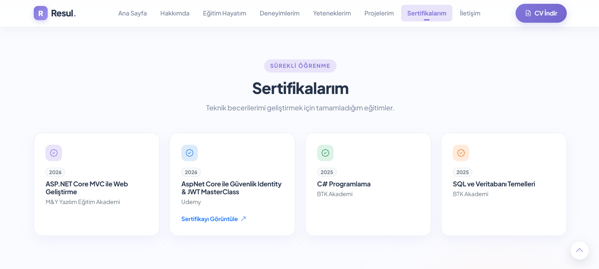
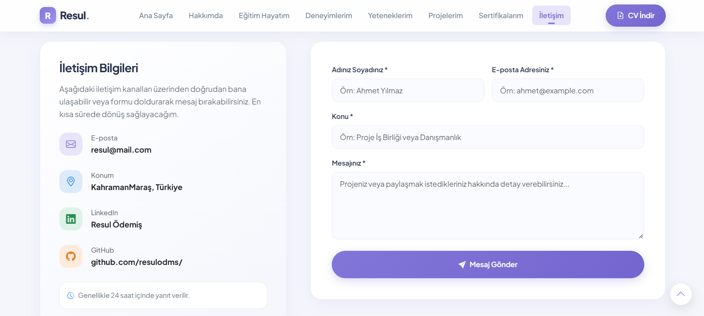
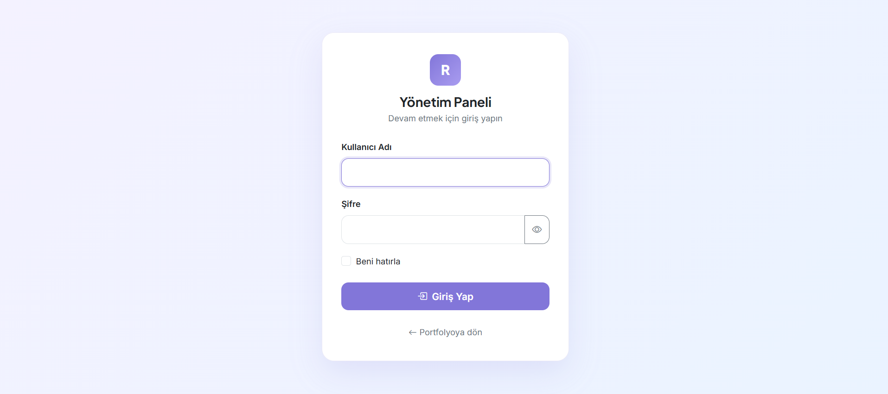
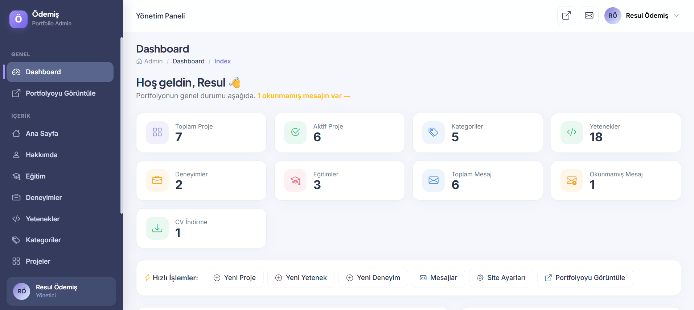
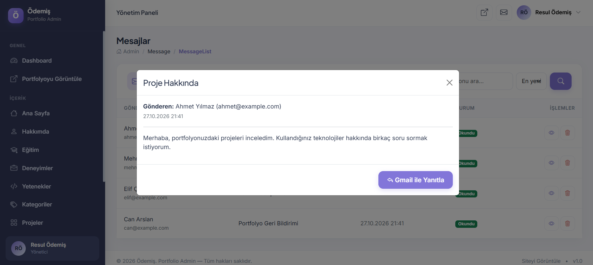
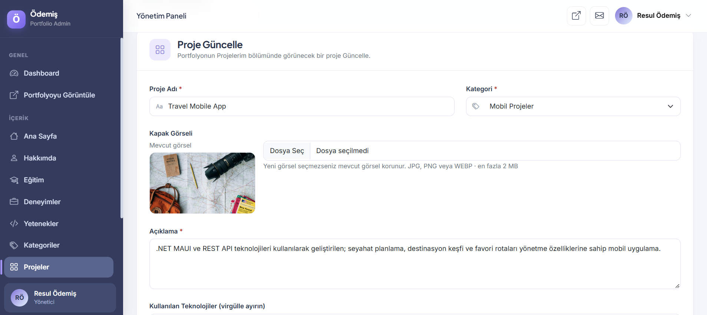
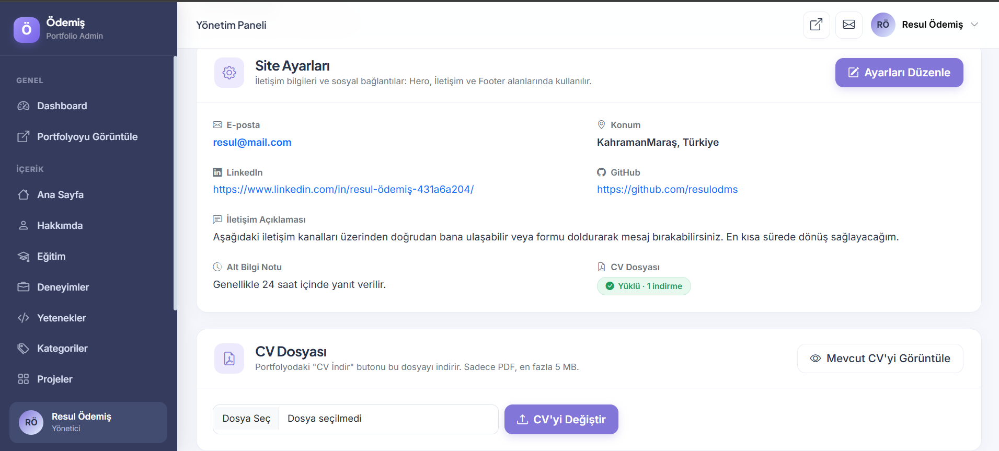

# 💼 Resul Portfolio - Admin Panelli Dinamik Portfolyo Sitesi

<p align="center">
  
</p>

**ASP.NET Core 9.0 MVC** ile geliştirilmiş, tüm içeriği bir **yönetim panelinden** düzenlenebilen kişisel portfolyo sitesi. Ziyaretçilerin gördüğü bölümler (Ana Sayfa, Hakkımda, Eğitim, Deneyim, Yetenekler, Projeler, Sertifikalar, İletişim) tamamen **SQL Server** veritabanından beslenir. **Entity Framework Core (Code First)**, **View Component** mimarisi, **Areas** yapısı ve **Cookie Authentication** kullanılmıştır.

> M&Y Yazılım Eğitim Akademi **12. Dönem Bootcamp** kapsamında, **1. Proje – Portfolyo Case** çalışması olarak geliştirilmiştir.

<p align="center">
  
  
  
  
  
  
</p>

---

## 📑 İçindekiler

- [Site Özellikleri](#-site-özellikleri)
- [Yönetim Paneli](#️-yönetim-paneli)
- [Case Gereksinimleri ve Karşılıkları](#-case-gereksinimleri-ve-karşılıkları)
- [Teknoloji Stack](#-teknoloji-stack)
- [Mimari](#️-mimari)
- [Veritabanı Şeması](#️-veritabanı-şeması)
- [Kurulum](#-kurulum)
- [Sayfalar ve Adresler](#-sayfalar-ve-adresler)
- [Proje Yapısı](#-proje-yapısı)
- [Kod Örnekleri](#-kod-örnekleri)
- [Teşekkür](#-teşekkür)

---

## 🌐 Site Özellikleri

### 🏠 Karşılama Alanı
Ad, unvan, tanıtım metni ve profil görseli admin panelinden yönetilir. GitHub, LinkedIn ve e-posta bağlantıları veritabanından gelir; aynı View Component hem karşılama alanında hem footer'da kullanılır. Navbar bağlantıları sayfadaki ilgili bölümlere kaydırır.

### 🎓 Eğitim, 💼 Deneyim ve 🏅 Sertifikalar
Kayıtlar tarih sırasına göre listelenir. Admin panelinde **pasif** yapılan kayıtlar sitede görünmez.

<table>
  <tr>
    <td width="50%" valign="top">
      
      <p align="center"><b>Deneyimler</b><br>Zaman çizelgesi görünümü, çalışma türü ve etiketler</p>
    </td>
    <td width="50%" valign="top">
      
      <p align="center"><b>Sertifikalar</b><br>Kurum, yıl ve isteğe bağlı sertifika bağlantısı</p>
    </td>
  </tr>
</table>

### 🧠 Yetenekler ve 🗂️ Projeler
- Yetenekler gruplara ayrılmış, **yüzde/seviye çubuklarıyla** gösterilir
- Projeler kart düzeninde listelenir; **kategoriye göre filtrelenebilir** (filtre butonları veritabanındaki kategorilerden otomatik oluşur)
- Kartlarda kapak görseli, kategori, teknoloji etiketleri, GitHub ve canlı demo bağlantıları bulunur

### ✉️ İletişim ve 📄 CV İndir
- İletişim formu **AJAX** ile sayfa yenilenmeden gönderilir; sunucu tarafında **Data Annotations** ile doğrulanır, hatalar ilgili alanın altında gösterilir
- Sonuç **SweetAlert2** ile bildirilir; mesaj doğrudan admin panelindeki gelen kutusuna düşer
- Navbar'daki **CV İndir** butonu admin panelinden yüklenen PDF'i indirir; indirme sayısı Dashboard'da izlenir

<p align="center">
  
</p>

---

## 🛠️ Yönetim Paneli

Admin paneli `Areas/Admin` altında yer alır ve **Cookie Authentication** ile korunur; giriş yapılmadan hiçbir yönetim sayfası açılmaz.

<p align="center">
  
</p>

### 📈 Dashboard
Tüm veriler sabit sayılarla değil **EF Core sorgularıyla** üretilir ve tek bir `DashboardViewModel` ile View'a taşınır.

- **İstatistik kartları:** toplam proje, aktif proje, kategori, yetenek, deneyim, eğitim, toplam mesaj, okunmamış mesaj, CV indirme sayısı
- **Son 5 mesaj:** gönderen, konu, tarih, okundu durumu; satıra tıklayınca mesaj detayı açılır
- **Son 3 proje:** kapak görseli, kategori, aktif/pasif durumu ve düzenleme bağlantısı
- **Kategori özeti:** `GroupBy` ile kategori bazında proje sayıları ve çubuk grafik
- **Hızlı işlemler:** yeni proje, yeni yetenek, mesajlar, site ayarları, portfolyoyu aç

<p align="center">
  
</p>

### 📥 Mesajlar ve 📝 İçerik Yönetimi

<table>
  <tr>
    <td width="50%" valign="top">
      
      <p align="center"><b>Gelen Mesajlar</b><br>Okundu/okunmadı etiketi, ada veya konuya göre arama, tarihe göre sıralama, okunmamış sayısı, Bootstrap Modal ile detay ve SweetAlert2 ile silme onayı</p>
    </td>
    <td width="50%" valign="top">
      
      <p align="center"><b>Proje Formu</b><br>Veritabanından gelen kategori dropdown'ı, görsel yükleme ve önizleme, sunucu tarafı doğrulama mesajları</p>
    </td>
  </tr>
</table>

### ⚙️ Site Ayarları ve CV Yükleme
İletişim bilgileri ve sosyal bağlantılar buradan güncellenir. CV yalnızca **PDF** olarak kabul edilir (en fazla 5 MB), benzersiz adla `wwwroot/cv` altına kaydedilir ve eski dosya otomatik silinir.

<p align="center">
  
</p>

### Yönetilebilen Bölümler

| Bölüm | İşlemler |
|---|---|
| Ana Sayfa (Hero), Hakkımda | Ekle / Güncelle / Sil (tek kayıt) |
| Eğitim, Deneyim, Yetenekler, Sertifikalar | Listele / Ekle / Güncelle / Sil + **Aktif/Pasif** |
| Kategoriler | Listele / Ekle / Güncelle / Sil (projesi olan kategori silinemez) |
| Projeler | Listele / Ekle / Güncelle / Sil + **kategori seçimi** + **görsel yükleme** |
| Mesajlar | Detay (Modal) / Okundu işaretle / Ara / Sırala / Sil |
| Site Ayarları | İletişim bilgileri + **PDF CV yükleme** |

### 🚫 Özel 404 Sayfası
Olmayan bir adrese gidildiğinde ya da bir kayıt bulunamadığında sitenin temasına uygun bir hata sayfası gösterilir. Admin panelinden gelindiyse "Panele Dön", siteden gelindiyse "Ana Sayfa" butonu çıkar.

---

## ✅ Case Gereksinimleri ve Karşılıkları

| # | Gereksinim | Uygulama |
|---|---|---|
| 01 | Yönetim paneli ve dinamik içerik | Tüm modüller için CRUD; pasif kayıtlar sitede gizli; renkli Aktif/Pasif etiketleri |
| 02 | İlişkili tablo ve kategori yönetimi | `Category` → `Project` bire-çok ilişki (FK + Navigation Property), `SelectList` dropdown, sitede kategori filtresi |
| 03 | Mesajlar ve iletişim | AJAX + Data Annotations doğrulaması, okundu/okunmadı, arama, sıralama, Modal detay, SweetAlert2 onayı; mesaj içeriği düzenlenemez |
| 04 | CV indir | Admin'den PDF yükleme (tür + boyut kontrolü), `PhysicalFile` ile indirme, indirme sayacı |
| 05 | Dashboard | `DashboardViewModel`, `Count`, `Where`, `Include`, `OrderByDescending`, `Take`, `GroupBy` |
| 06 | Araştırılan teknikler | `Required`, `StringLength`, `Range`, `EmailAddress`, `ModelState.IsValid`, `TempData`, `IFormFile` |
| 07 | Ek geliştirmeler | Boş liste mesajları, responsive tablolar, kategori grafiği, CV indirme sayacı, **admin girişi**, **özel 404 sayfası** |

---

## 🔧 Teknoloji Stack

| Teknoloji | Versiyon | Açıklama |
|---|---|---|
| **.NET** | 9.0 | Microsoft .NET |
| **ASP.NET Core MVC** | 9.0 | Web uygulama çatısı (Areas yapısı ile) |
| **Entity Framework Core** | 9.0.20 | ORM (Code-First + Migrations) |
| **SQL Server** | Express | İlişkisel veritabanı |
| **Cookie Authentication** | 9.0 | Admin girişi (ek paket gerektirmez) |
| **View Components** | 9.0 | Site bölümlerinin parçalı yapısı |
| **Bootstrap** | 5.3 | Site ve admin arayüzü |
| **Bootstrap Icons** | 1.11 | İkonlar |
| **SweetAlert2** | 11 | Bildirimler ve silme onayları |

---

## 🏗️ Mimari

Site ve admin paneli aynı projededir; admin tarafı **Areas** ile ayrılmıştır.

```
  Ziyaretçi ───▶ DefaultController            (herkese açık)
                   ├─ Index      → View Components: Navbar, HeroSection, About, Education,
                   │                Experience, Skill, Project, Certificate, Contact, SocialLinks
                   ├─ SendMessage (AJAX, POST)
                   └─ DownloadCv

  Admin ───▶ LoginController ──(Cookie)──▶ Areas/Admin  [Authorize]
                                           Dashboard, HeroSection, About, Education,
                                           Experience, Skill, Category, Project,
                                           Certificate, Message, Contact
                                                     │
                                                     │ EF Core
                                                     ▼
                                           SQL Server · ResPortfolio

  Hatalar ───▶ ErrorController  (UseStatusCodePagesWithReExecute → /Error/{kod})
```

---

## 🗄️ Veritabanı Şeması

```
📊 Veritabanı: ResPortfolio (SQL Server)

├── HeroSections   → Karşılama alanı (başlık, ad, tanıtım metni, profil görseli)
├── Abouts         → Hakkımda (ad soyad, unvan, konum, uzmanlık, e-posta, açıklama)
├── Educations     → Eğitim (okul, bölüm, süre, konum, etiketler, aktif/pasif)
├── Experiences    → Deneyim (pozisyon, şirket, süre, çalışma türü, etiketler, aktif/pasif)
├── Skills         → Yetenekler (ad, yüzde, grup, sıra, aktif/pasif)
├── Categories     → Proje kategorileri
│     └── 1 ─── N
├── Projects       → Projeler (başlık, açıklama, görsel, GitHub, demo, etiketler, CategoryId FK)
├── Certificates   → Sertifikalar (ad, kurum, tarih, bağlantı, aktif/pasif)
├── Messages       → Gelen mesajlar (ad soyad, e-posta, konu, mesaj, tarih, okundu)
└── Contacts       → Site ayarları (e-posta, konum, GitHub, LinkedIn, CV yolu, indirme sayısı)
```

> Admin kullanıcı bilgileri veritabanında değil `appsettings.json` içinde tutulur. Yüklenen proje görselleri `wwwroot/images/projects`, CV ise `wwwroot/cv` altında saklanır.

---

## 🚀 Kurulum

### Gereksinimler

- [.NET 9.0 SDK](https://dotnet.microsoft.com/download)
- [SQL Server](https://www.microsoft.com/sql-server) (Express yeterli)
- Visual Studio 2022

### 1. Depoyu Klonlayın

```bash
git clone https://github.com/resulodms/resul_portfolio.git
cd resul_portfolio
```

### 2. Veritabanı Bağlantısını Kontrol Edin

`Resul_Portfolio/appsettings.json` içindeki bağlantı dizesi varsayılan olarak yerel SQL Server Express'i kullanır. Farklı bir sunucu kullanıyorsanız güncelleyin:

```json
"ConnectionStrings": {
  "conn": "Server=.\\SQLEXPRESS;Database=ResPortfolio;integrated security=true;trustservercertificate=true"
}
```

### 3. Veritabanını Oluşturun

Visual Studio'da **Tools → NuGet Package Manager → Package Manager Console**:

```powershell
Update-Database
```

### 4. Uygulamayı Çalıştırın

`Resul_Portfolio.sln` dosyasını açın ve **F5** ile çalıştırın.

### 5. Admin Paneline Giriş

| | |
|---|---|
| **Giriş adresi** | `/Login/Index` (ya da doğrudan `/Admin`) |
| **Kullanıcı adı** | `admin` |
| **Şifre** | `Resul123!` |

> Giriş bilgileri `appsettings.json` içindeki `AdminUser` bölümünden değiştirilebilir. Veritabanı ilk oluşturulduğunda boştur; içerikleri admin panelinden ekleyebilirsiniz. Ana sayfanın tam görünmesi için **Ana Sayfa (Hero)**, **Hakkımda** ve **Site Ayarları** bölümlerinde birer kayıt bulunmalıdır.

---

## 🧭 Sayfalar ve Adresler

| Adres | Açıklama | Erişim |
|---|---|---|
| `/` | Portfolyo sitesi | Herkese açık |
| `/Default/DownloadCv` | CV indirme | Herkese açık |
| `/Login/Index` | Admin girişi | Herkese açık |
| `/Admin/Dashboard/Index` | Dashboard | Admin |
| `/Admin/HeroSection/HeroSectionList` | Ana sayfa yönetimi | Admin |
| `/Admin/About/AboutList` | Hakkımda yönetimi | Admin |
| `/Admin/Education/EducationList` | Eğitim yönetimi | Admin |
| `/Admin/Experience/ExperienceList` | Deneyim yönetimi | Admin |
| `/Admin/Skill/SkillList` | Yetenek yönetimi | Admin |
| `/Admin/Category/CategoryList` | Kategori yönetimi | Admin |
| `/Admin/Project/ProjectList` | Proje yönetimi | Admin |
| `/Admin/Certificate/CertificateList` | Sertifika yönetimi | Admin |
| `/Admin/Message/MessageList` | Gelen mesajlar | Admin |
| `/Admin/Contact/ContactList` | Site ayarları ve CV yükleme | Admin |

---

## 📁 Proje Yapısı

```
resul_portfolio/
├── README.md
├── screenshots/                        # README görselleri
├── Resul_Portfolio.sln
└── Resul_Portfolio/                    # ASP.NET Core MVC projesi
    ├── Areas/Admin/
    │   ├── Controllers/                # Dashboard, HeroSection, About, Education, Experience,
    │   │                               #   Skill, Category, Project, Certificate, Message, Contact
    │   └── Views/                      # List / Create / Update sayfaları + AdminLayout
    ├── Context/PortfolioContext.cs
    ├── Controllers/                    # Default (site), Login, Error
    ├── Entities/                       # HeroSection, About, Education, Experience, Skill,
    │                                   #   Category, Project, Certificate, Message, Contact
    ├── Migrations/                     # EF Core migration'ları
    ├── Models/                         # DashboardViewModel, HeroViewModel, LoginViewModel
    ├── ViewComponents/                 # Site bölümleri
    ├── Views/
    │   ├── Default/                    # Site ana sayfası
    │   ├── Login/                      # Admin giriş sayfası
    │   ├── Error/                      # Özel 404 sayfası
    │   └── Shared/Components/          # View Component görünümleri
    ├── wwwroot/
    │   ├── images/projects/            # Yüklenen proje görselleri
    │   └── cv/                         # Yüklenen CV
    ├── appsettings.json                # Bağlantı dizesi ve admin giriş bilgileri
    └── Program.cs                      # Kimlik doğrulama, hata sayfası ve route ayarları
```

---

## 📝 Kod Örnekleri

### Dashboard: Kategori Bazında Proje Sayısı (GroupBy)

```csharp
CategoryStats = _context.Projects
    .GroupBy(x => x.Category!.CategoryName)
    .Select(g => new CategoryProjectCount
    {
        CategoryName = g.Key,
        ProjectCount = g.Count()
    })
    .OrderByDescending(y => y.ProjectCount)
    .ToList()
```

### Sadece PDF Kabul Eden CV Yükleme

```csharp
if (Path.GetExtension(cvFile.FileName).ToLower() != ".pdf")
{
    TempData["Error"] = "Sadece PDF dosyası yükleyebilirsiniz.";
    return RedirectToAction("ContactList");
}
if (cvFile.Length > 5 * 1024 * 1024)
{
    TempData["Error"] = "CV dosyası en fazla 5 MB olabilir.";
    return RedirectToAction("ContactList");
}

var fileName = $"{Guid.NewGuid()}.pdf";
using (var stream = new FileStream(Path.Combine(_env.WebRootPath, "cv", fileName), FileMode.Create))
{
    cvFile.CopyTo(stream);
}
contact.CvFilePath = $"/cv/{fileName}";
```

### İletişim Formu: Sunucu Tarafı Doğrulama ve JSON Yanıt

```csharp
[HttpPost]
[ValidateAntiForgeryToken]
public IActionResult SendMessage(Message message)
{
    message.SendDate = DateTime.Now;
    message.IsRead = false;

    if (!ModelState.IsValid)
    {
        var errors = ModelState.Where(x => x.Value.Errors.Any())
            .ToDictionary(x => x.Key, x => x.Value.Errors.First().ErrorMessage);
        return BadRequest(new { success = false, errors });
    }

    _context.Messages.Add(message);
    _context.SaveChanges();
    return Ok(new { success = true, message = "Mesajınız başarıyla iletildi." });
}
```

---

## 🎓 Bu Projede Öğrenilenler

- ✅ ASP.NET Core 9.0 **MVC** mimarisi ve **Areas** ile admin paneli ayrımı
- ✅ **Entity Framework Core** Code-First, Migration ve **bire-çok ilişki**
- ✅ **View Component** ile parçalı sayfa yapısı
- ✅ **Data Annotations** ve `ModelState.IsValid` ile sunucu tarafı doğrulama
- ✅ **AJAX** ile sayfa yenilemeden form gönderimi
- ✅ `IFormFile` ile **dosya yükleme**, tür/boyut kontrolü ve benzersiz dosya adı
- ✅ LINQ ile raporlama (`Include`, `Where`, `Count`, `GroupBy`, `OrderByDescending`, `Take`)
- ✅ **Bootstrap Modal**, **SweetAlert2** ve `TempData` ile kullanıcı bildirimleri
- ✅ **Cookie Authentication** ve özel hata sayfası

---

## 🙏 Teşekkür

Bu proje, **M&Y Yazılım Eğitim Akademi 12. Dönem Bootcamp** kapsamında geliştirilmiştir. Eğitim süreci ve değerli katkıları için eğitmenimiz **Murat Yücedağ**'a teşekkür ederim.

---

<p align="center">
  <b>⭐ Bu projeyi yararlı bulduysanız star vermeyi unutmayın! ⭐</b><br>
  Resul Ödemiş tarafından ASP.NET Core & SQL Server ile geliştirildi.
</p>
